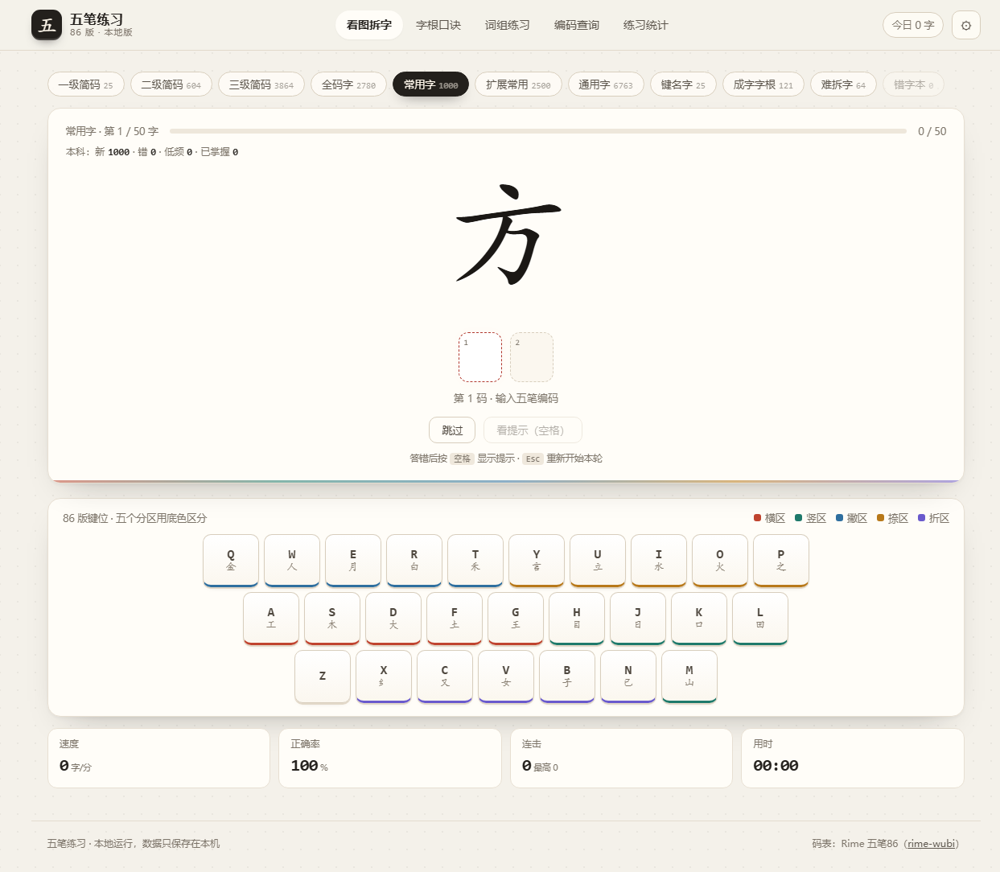
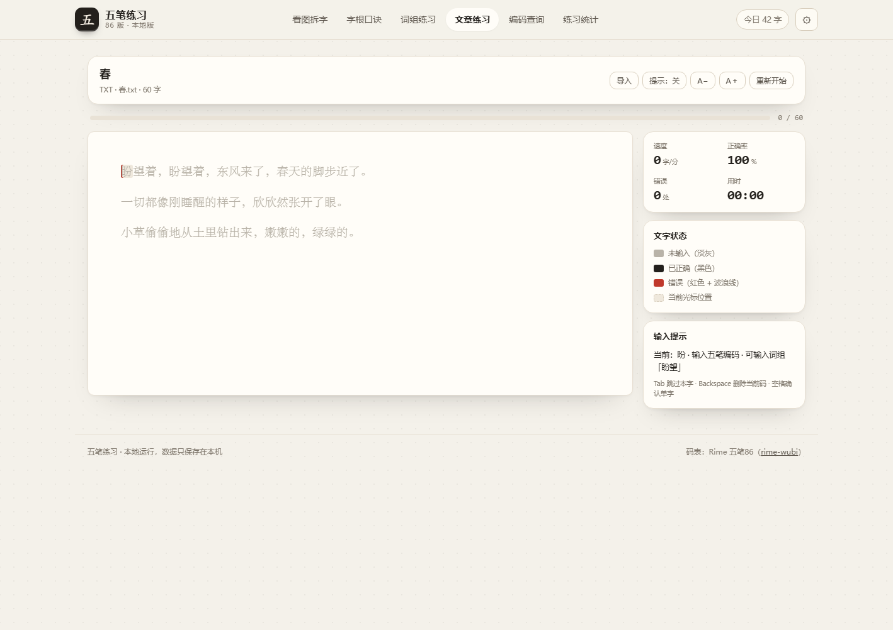

# 五笔练习 · 本地版

一个完全离线、无需账号的五笔（86 版）打字练习网页工具。服务端是 Python 标准库 + SQLite，
前端是原生 HTML/CSS/JS，没有构建步骤，练习数据只保存在本机。

参考「巧手打字通」的看图拆字结构，并扩展了学习状态、文章练习和逐字拆字提示。



## 功能一览

| 模块 | 说明 |
| --- | --- |
| 看图拆字 | 按字库出字，逐码输入；默认不显示编码提示，答错一次后按 `空格` 才显示当前码的键位与口诀 |
| 学习状态 | 每个字库/词库独立记录 new / low / error / mastered，按 45% / 45% / 10% 分桶出题 |
| 错题本 | 跨科目的错题视图；在错题本里练对会回写所有来源科目 |
| 错字拆字 | 文章、单字、词组打错后显示正确的字根字形 + 键位；常用字覆盖 6,756 个 |
| 识别码归类 | 显示“末笔 × 字型 → 识别码（区位）”，例如 明=横·左右→G（1 区 1 位） |
| 字根口诀 | 25 键字根表、口诀、键位反应练习 |
| 词组练习 | 二字 / 三字 / 四字词，按词取码，规则与单字相同 |
| 文章练习 | 导入 `.txt` / `.docx`，按原文结构排版逐字输入；支持单字或词组码、标点映射、进度续练 |
| 编码查询 | 汉字查编码，字母反查同码字词 |
| 练习统计 | 正确率、速度、连续天数、各科进度、最近练习、错题本 |

## 快速启动

### 环境

- Python 3.9+（Windows 10/11 已验证）
- docx 解析需要 [python-docx](https://python-docx.readthedocs.io/)（本机使用 1.2.0）
- 其余服务端代码只用标准库；前端无需 Node/npm/构建工具

```powershell
cd 五笔练习
python -m pip install python-docx
python app.py
```

浏览器会自动打开 <http://127.0.0.1:8765/>。

Windows 也可以直接双击 `run.bat`。`run.bat` 会优先使用本机 conda 的
`C:\ProgramData\Anaconda3\python.exe`，找不到时回退到 `python`。

常用参数：

```powershell
python app.py --port 9000        # 换端口
python app.py --no-open          # 不自动打开浏览器
```

服务默认只监听 `127.0.0.1`，不对外网开放；所有数据只在本机。

## 使用方式

### 快捷键

| 按键 | 作用 |
| --- | --- |
| 字母键 | 输入当前字/词的五笔编码，输完自动进入下一项 |
| `空格` | 答错后查看提示；文章练习中用于确认单字 |
| `Esc` | 重新开始当前一轮 |
| `Tab` | 文章练习：跳过当前字；其他页面按浏览器默认行为 |
| `Backspace` | 文章练习：删除当前字的编码缓冲；不会跨字回退 |

### 设置

右上角 ⚙：

- 每轮 20 / 50 / 100 项；
- 简码优先 / 全码；
- 初学模式：始终显示提示（**不记录学习状态**）；
- 按键音效；
- 重置全部学习进度。

设置保存在浏览器 `localStorage` 的 `wubi.prefs.v2`。

## 学习状态规则

每个科目独立记录每个字/词：

| 状态 | 进入条件 | 出题占比 |
| --- | --- | --- |
| 未出现 `new` | 该科目从未练过 | 45% |
| 错题 `error` | 出现错键、提示或跳过 | 45% |
| 低频 `low` | 第一次出现就全对 | 10% |
| 已掌握 `mastered` | 连续 3 次全对 | 0，不再出现 |

状态转换：

```text
new ──第一次全对──> low 1/3
new ──错键/提示/跳过──> error 0/3

low 1/3 ──全对──> low 2/3 ──全对──> mastered
low 任意 ──错误──> error 0/3

error 0/3 ──全对──> error 1/3 ──全对──> error 2/3 ──全对──> mastered
error 任意 ──错误──> error 0/3
```

- “全对”指没有错键、没有用提示、没有跳过；第一次全对也计入 1/3。
- “低频”不是字频低的字表，而是学习状态 `low`；它在出题中占 10%，所以叫低频。
- 任意一次错误都会把连对清零，并回到错题。
- 掌握后记录保留，但不再抽到；统计页可重置单科或全部。
- 字和词的状态互相独立：`春` 掌握不代表 `春天` 掌握；同一个字在 `常用字` 和 `通用字` 里也各算各的。
- 文章练习使用独立进度，不写入上述科目状态，也不自动进错题本。

## 错字拆字与识别码

打错后：

- **文章练习**：纸面下方出现“错字纠正”卡，显示目标字、全码、键位和字根字形。
- **看图拆字**：在提示行下方、操作按钮上方展开根条，提示行仍保留“第 N 码 · 按 X 键 —— 口诀”。
- **词组练习**：同一位置按词中每个字横向分栏，最多 4 栏。

字根使用 **PUA 字形 + 键位字母** 显示，不是普通汉字文本。常用字数据覆盖 6,756 字；
未覆盖字显示“码位键位字根”，不冒充逐字拆解。

识别码会额外归类：

| 末笔 \ 字型 | 左右 | 上下 | 杂合 |
| --- | --- | --- | --- |
| 横（一） | G / 11 | F / 12 | D / 13 |
| 竖（丨） | H / 21 | J / 22 | K / 23 |
| 撇（丿） | T / 31 | R / 32 | E / 33 |
| 捺（丶） | Y / 41 | U / 42 | I / 43 |
| 折（乛） | N / 51 | B / 52 | V / 53 |

例如：

- 明：识别码 = 末笔横 · 左右型 → **G（1 区 1 位）**
- 天：识别码 = 末笔捺 · 杂合型 → **I（4 区 3 位）**
- 汉：识别码 = 末笔捺 · 左右型 → **Y（4 区 1 位）**
- 春：识别码 = 末笔横 · 上下型 → **F（1 区 2 位）**

设计图：

- [错字纠正卡](docs/root-hint-design.svg)
- [字词练习中的位置](docs/root-hint-placement.svg)

## 文章练习



### 支持格式

- `.txt`：自动检测 UTF-8 / UTF-16 BOM / GB18030（兼容 GBK、GB2312）；保留换行、空行、行首空格、制表符。
- `.docx`：使用 `python-docx` 解析段落、运行样式、对齐、缩进、段前段后、行距、标题、列表、表格、图片、分页。
- 单文件上限 **10 MB**，单篇最多 **20,000 字**。
- 图片只展示，不参与输入；不执行宏，不访问外部资源。

### 输入规则

- 中文按五笔编码（沿用简码/全码设置）；也支持当前文章位置、词库中收录的 2–4 字**词组码**。
- 单字码正好是某词组前缀时：继续输入可完成词组，按 `空格` 确认单字；下一个键若不能接成词组，会先落单字再处理该键。
- 中文标点映射到键盘标点，例如 `，→ ,`、`。→ .`、`、→ \`、`？→ ?`；英文/数字按原字符。
- 打错后留在当前字重试，`Tab` 标红跳过；`Backspace` 只删除当前字缓冲。
- 进度每 20 字或 2 秒批量保存，刷新/重开可继续；完成后写入统计。
- docx 是**结构级还原**：不模拟 Word 纸张分页、页眉页脚、文本框、公式等像素级版式。

## 字库

| 字库 | 数量 | 说明 |
| --- | --- | --- |
| 一级简码 | 25 | 我人有的和主产不为这民了发以经工要在地一上是中国同 |
| 二级简码 | 604 | 两码上屏 |
| 三级简码 | 3,864 | 三码上屏 |
| 全码字 | 2,780 | 需要四码 |
| 常用字 / 扩展常用 | 1,000 / 2,500 | 按字频排序的 GB2312 常用字 |
| 通用字 | 6,763 | GB2312 全部汉字 |
| 键名字 / 成字字根 / 难拆字 | 25 / 121 / 64 | 专项练习 |
| 错题本 | 动态 | 各科错题的跨科视图 |

词组：二字词 12,000、三字词 4,519、四字词 6,000。

「简码优先」按最短编码（如「的」只按 `R`）；「全码」要求完整四码（`RQYY`）。

## 数据来源与许可

> 这一节很重要。上传 GitHub 前请先读。

### 编码、字库与字频

- 来源：[rime/rime-wubi](https://github.com/rime/rime-wubi) 的 86 版五笔码表，
  由极点五笔码表转换，含 Google 字频。
- 本项目生成的文件：`data/chars.json`、`data/words.json`、`data/pools.json`。
- 原始码表参考：`_ref/wubi86.dict.yaml`（仅构建参考，运行时不读取）。
- 字根表/口诀：86 版五笔传统字根口诀，整理在 `tools/build_data.py`，生成 `data/keys86.json`。
- 使用/再分发前请核对上游仓库的许可证。

### 逐字拆字数据与字根字体

**字根相关部分来自 [hantang/search-wubi](https://github.com/hantang/search-wubi)。**

本项目使用该仓库中的：

| 文件 | 用途 |
| --- | --- |
| `data/data-wubi-v86.tsv` | 逐字 `units`（PUA 字根字形）、`flag`（识别码）、`segments`（笔画段） |
| `data/data-chars.tsv` | 字级、IDS、部首，用于常用字筛选和校验 |
| `docs/static/font/黑体字根.ttf` | 渲染 PUA 字根字形的字体 |

生成结果：

- `data/char_roots.json`：6,756 个常用字；7 个编码不一致/特殊部首跳过（氵、纛、蔻、钅、灬、靥、囗）；
- `web/fonts/wubi-roots.ttf`：从上面的字体复制；
- `tools/build_char_roots.py`：构建脚本。

据 `hantang/search-wubi` 的 README，其字根拆解和对应字体来自 **86wb.ysepan.com**。
本项目只是本地使用这些数据/字体，不修改原始授权。

> **许可证提醒**：本机这份 `search-wubi-main` 副本中**没有看到 LICENSE 文件**。
> 如果要把 `data/char_roots.json` 和 `web/fonts/wubi-roots.ttf` 一起公开上传到 GitHub，
> 请先确认 hantang/search-wubi 及上游 86wb.ysepan.com 的再分发许可；未确认前建议不要公开提交这两个文件。
> 删除它们后程序仍可运行，拆字提示会降级为“码位键位字根”。

### 运行时不需要源仓库

`search-wubi-main/` 和 `search-wubi-main.zip` **不是运行时依赖**，只用于重新生成 `char_roots.json`/字体。
GitHub 上传时建议删除或忽略，原因：体积大（源目录约 56 MB、zip 约 36 MB），且许可未明。

## 技术架构

```text
浏览器（原生 HTML/CSS/JS，无构建）
  ├─ 练习页 / 文章页 / 字根页 / 查询页 / 统计页
  ├─ localStorage 偏好
  └─ fetch /api/*
        │
Python 本地服务（app.py，标准库 ThreadingHTTPServer）
  ├─ 静态文件 /data /static
  ├─ 学习状态 / 成绩 / 错题本 API
  ├─ 文章导入 / 进度 / 统计 API
  └─ SQLite data/progress.db（WAL）
```

- 服务端只监听 `127.0.0.1`；
- 没有外网请求、没有账号、没有遥测；
- 前端是单页 hash 路由：`#/five`、`#/words`、`#/article`、`#/roots`、`#/dict`、`#/stats`；
- 文章解析在 `article_parser.py`，docx 使用 `python-docx`；
- 数据库首次启动自动创建，WAL 模式。

### 数据库表

| 表 | 内容 |
| --- | --- |
| `sessions` | 每轮成绩：模式、科目、总数、正确/错误、时长、速度 |
| `item_state` | 科目内每个字/词的学习状态与连对 |
| `articles` | 文章元数据与解析后的文档 JSON |
| `article_progress` | 文章光标、正确/错误、用时、完成时间 |
| `article_chars` | 文章逐字状态（correct/error） |
| `err_chars` | 旧版错字表，保留用于迁移；新逻辑不再写它 |

### HTTP API（本地）

| 方法 | 路径 | 说明 |
| --- | --- | --- |
| GET | `/api/health` | 健康检查 |
| GET | `/api/stats` | 总统计、学习状态、错题本、最近练习 |
| GET | `/api/learning?pool=...` | 某科目状态与计数 |
| GET | `/api/errors` | 跨科错题视图 |
| GET | `/api/articles` | 文章列表 |
| GET | `/api/articles/{id}` | 文章详情 + 进度 |
| POST | `/api/attempt` | 一次 perfect/error 判定 |
| POST | `/api/session` | 普通一轮成绩 |
| POST | `/api/learning/reset` | 重置某科/全部学习状态 |
| POST | `/api/articles` | 导入文章（base64） |
| PATCH | `/api/articles/{id}/progress` | 保存文章进度 |
| POST | `/api/articles/{id}/session` | 文章完成成绩 |
| POST | `/api/articles/{id}/reset` | 重置文章进度 |
| DELETE | `/api/articles/{id}` | 删除文章与媒体 |
| GET | `/media/articles/{id}/{file}` | 文章图片 |

## 目录

```text
app.py                    本地 HTTP 服务 + SQLite + API
article_parser.py         txt / docx → 文档模型
run.bat                   Windows 一键启动
web/
  index.html              页面骨架
  style.css               样式
  app.js                  练习引擎、学习状态、文章、字根、查询、统计
  fonts/wubi-roots.ttf    PUA 字根字形字体
data/
  keys86.json             25 键字根 / 口诀 / 分区
  chars.json              单字 → 简码 / 全码
  char_roots.json         6,756 常用字逐字拆解（PUA + 键位 + 识别码）
  words.json              词组 → 编码
  pools.json              各字库
  progress.db             运行后自动生成（练习记录/学习状态/文章）
  article_media/          运行后生成（docx 图片）
  progress.db.bak-v1      升级学习状态前的备份（如存在）
docs/
  design.md               系统设计（v1 基线）
  learning-state-design.md 学习状态设计（v2）
  article-practice-design.md 文章练习设计
  root-hint-design.md     拆字提示/识别码设计
  article-design/*.svg    文章练习设计图
  root-hint-design.svg    错字纠正卡设计
  root-hint-placement.svg 字词练习位置图
  preview.png             看图拆字截图
  article-preview.png     文章练习截图
  五笔练习详细设计文档.docx/pdf  v1 基线设计文档
tools/
  build_data.py           从码表生成 data/*.json
  build_char_roots.py     从 search-wubi-main 生成 char_roots.json/字体
  build_design_docx.py    从 design.md 生成 Word
  e2e_test.py             CDP 端到端冒烟测试
  test_learning_state.py  学习状态接口测试（临时库）
  test_article_api.py     文章接口测试（临时库）
  test_char_roots.py      拆字数据校验
_ref/
  wubi86.dict.yaml        码表原始文件（可选，不参与运行时）
search-wubi-main/         字根拆解源仓库（可选，仅构建；上传 GitHub 前建议删除）
```

## 测试

```powershell
# 学习状态
python tools/test_learning_state.py

# 文章解析/进度/统计（需要 Pillow，测试里会生成一张小图）
python tools/test_article_api.py

# 拆字数据
python tools/test_char_roots.py
```

端到端测试需要 Chrome 和运行中的服务：

```powershell
# 终端 1
python app.py --no-open

# 终端 2：Chrome 以调试端口启动
chrome.exe --headless=new --remote-debugging-port=9222 --user-data-dir=%TEMP%\wb-e2e

# 终端 3
$env:WUBI_BASE="http://127.0.0.1:8765"
python tools/e2e_test.py
```

注意：端到端测试会写入服务端数据库，建议用临时库或先备份 `data/progress.db`。

## 上传 GitHub 前检查

### 1. 不要提交个人数据

必须排除：

```gitignore
__pycache__/
*.py[cod]
data/progress.db
data/progress.db-wal
data/progress.db-shm
data/progress.db.bak-*
data/article_media/
_ref/
search-wubi-main/
search-wubi-main.zip
*.log
```

`data/progress.db` 含你的练习记录、文章和文章图片；`progress.db.bak-v1` 也可能含个人信息。
`data/article_media/` 是导入 docx 后生成的图片。

### 2. 决定字根数据/字体是否公开

`data/char_roots.json` 和 `web/fonts/wubi-roots.ttf` 来自 `hantang/search-wubi`（及上游 86wb.ysepan.com）。
本机副本未发现 LICENSE 文件。公开提交前必须确认再分发许可。

如果未取得许可：

- 不提交这两个文件；
- 程序仍能启动；未覆盖字会显示“码位键位字根”；
- 在 README 的“数据来源”中保留 attribution。

### 3. 项目许可证

目标 GitHub 仓库根目录已有一份 **Apache-2.0 LICENSE**。代码提交后按该许可证发布；
如需换许可证，请先替换根目录 `LICENSE`，不要在提交时删除它。

第三方数据/字体不自动适用项目代码许可证，请在 README 或 `THIRD_PARTY_NOTICES.md` 中分别列出：

- Rime/rime-wubi 数据许可；
- hantang/search-wubi 及 86wb.ysepan.com 的字根/字体许可；
- python-docx 等依赖许可。

### 4. 建议不上传的旧文档

`docs/五笔练习详细设计文档.docx/pdf` 是 v1 基线版本，和当前实现已有差异；
它们可以保留在本机，不一定要放进 GitHub。当前准确设计以 Markdown 文档为准。

### 5. 检查预览图

`docs/preview.png`、`docs/article-preview.png` 不应包含你的个人文章或真实成绩；
当前图片是示例内容。

## 已知限制

- 只实现 86 版五笔；98 版码表不同。
- 识别码有分类提示，但没有单独的“识别码题库”。
- 字根提示是逐字字形 + 键位；未覆盖字显示码位字根，不保证逐字唯一拆法。
- 文章 docx 是结构级还原，不保证 Word 分页、页眉页脚、文本框、公式完全一致。
- 文章单文件 10 MB、单篇 20,000 字；超过会拒绝导入。
- 不支持移动端软键盘；文章练习依赖实体键盘。
- 没有账号同步；换电脑需手动复制 `data/progress.db`。
- 服务只适合本机使用，不要直接暴露到公网。

## 致谢

- 编码与字频：[rime/rime-wubi](https://github.com/rime/rime-wubi)
- 字根拆解、字根字体：[hantang/search-wubi](https://github.com/hantang/search-wubi)
- 字根拆解/字体上游标注：86wb.ysepan.com
- docx 解析：[python-docx](https://python-docx.readthedocs.io/)

项目仅供本地学习使用；第三方数据/字体的版权与许可归各自权利人所有。
