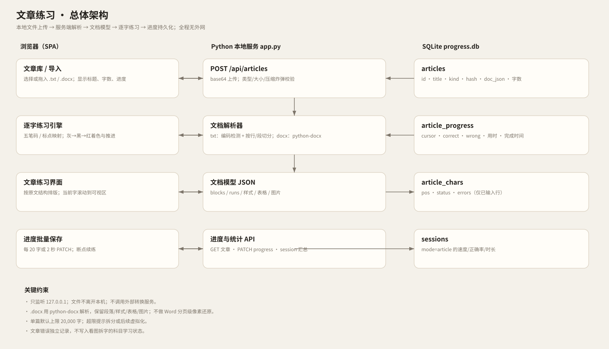
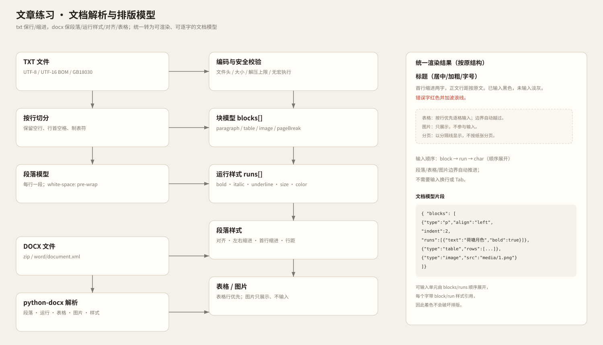
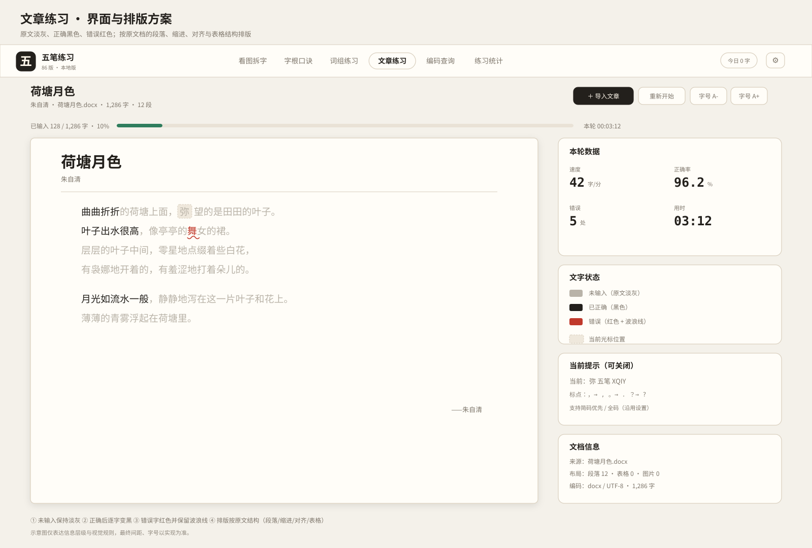
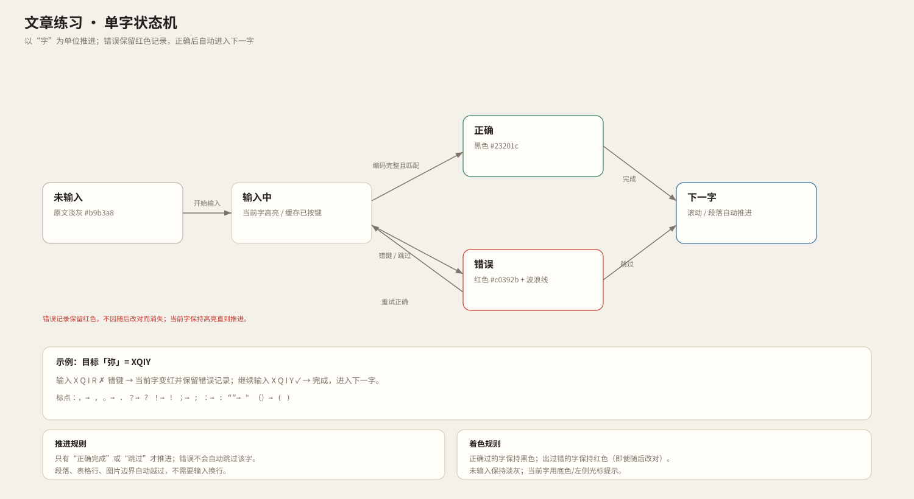

# 文章输入练习 · 详细设计（v1.0 已实施）

| 项目 | 内容 |
| --- | --- |
| 文档版本 | 1.1（已实施，含单字/词组混合输入） |
| 日期 | 2026-11-23 |
| 状态 | 已按本文实现并通过接口/UI 测试 |
| 功能 | 导入 txt/docx 文章，按原文排版逐字输入；未输入淡灰、正确黑色、错误红色 |
| 影响范围 | 新增“文章练习”页面、文档解析器、逐字引擎、文章库/进度表、上传与统计接口 |
| 设计图 | `docs/article-design/` 下 4 张 SVG |

> 文章练习是独立模式：**文章错误不写入看图拆字的科目学习状态**，避免污染现有 `item_state`。
> 实现采用本文推荐默认值：五笔码输入、错误留在当前字重试（红色保留）、结构级排版、文章错误独立。
> 直输（IME）模式列为后续可选项，首版未实现。

---

## 0. 评审摘要

新增一个“文章练习”页：

1. 用户选择本地 `.txt` 或 `.docx`，上传到本地服务解析。
2. 文章按原文结构渲染：txt 保留换行/空行/行首空格；docx 保留段落、缩进、对齐、字号/加粗、表格等。
3. 每个字初始为淡灰色；用户按顺序输入，正确变黑，错误标红并加波浪线。
4. 中文按五笔编码输入；标点按固定映射键输入；英文/数字按原字符输入。
5. 进度（光标、每个字的颜色、正确/错误数、用时）实时保存，可断点续练。
6. 文章练习独立于现有科目学习状态；文章成绩计入统计页的“文章”类型。

**需要重点确认的 4 件事**：

- 中文到底按**五笔编码**输入，还是按**普通字符（IME）**输入？
- 打错后是**留在当前字重试**（推荐），还是**立即跳过、标红**？
- 排版要**结构级还原**（推荐），还是必须**Word 像素级/分页还原**？
- 进度是否保存、文章错误是否并入现有错题本？

---

## 1. 需求与范围

### 1.1 原始需求

| 编号 | 需求 |
| --- | --- |
| R1 | 用户可以指定一个 txt 或 docx 文档 |
| R2 | 在网页上按字输入，原文以淡灰色显示 |
| R3 | 按顺序输入字符和标点 |
| R4 | 输入正确显示黑色，打错的字显示红色 |
| R5 | 排版与原 txt/docx 相同 |

### 1.2 范围

**包含**

- txt：UTF-8 / UTF-16（BOM）/ GB18030（兼容 GBK、GB2312）编码；保留换行、空行、行首空格、制表符。
- docx：段落、运行（粗体/斜体/下划线/字号/字体/颜色）、对齐、左右缩进、首行缩进、段前段后、行距、标题、列表、表格、图片（只展示）、分页符。
- 逐字输入、着色、当前字定位、自动滚动、进度保存/继续、重新开始、删除文章。
- 文章库、导入、进度统计。

**不包含（建议）**

- Word 页眉页脚、脚注尾注、文本框、艺术字、SmartArt、公式的精确排版。
- Word 纸张分页和像素级字体度量（除非后续改用 PDF 渲染方案）。
- 图片 OCR、扫描件。
- 移动端软键盘（文章练习依赖实体键盘）。

---

## 2. 关键设计决策

### 2.1 输入模式（最重要）

文章练习有两种可能的输入语义：

| 模式 | 中文输入 | 标点 | 与现有产品的关系 |
| --- | --- | --- | --- |
| **A. 五笔模式（推荐）** | 按该字的五笔编码逐键输入 | 映射到 ASCII 键 | 延续“五笔练习”定位 |
| B. 直输模式 | 浏览器 IME 直接输入汉字 | 直接输入中文标点 | 更像通用打字网站，需处理 IME 组合 |

**建议 v1 做 A**，因为当前应用是五笔练习工具，且现有码表/键位/简码模式都能直接复用。
B 作为后续可选项（本文 6.3 给出方案，不进入首版）。

五笔模式下：

- 目标汉字从 `data/chars.json` 取练习码（沿用“简码优先 / 全码”设置）。
- 用户按键与目标码逐键比对；错误键立即把该字标红并记录一次错误。
- 标点走固定映射（见附录 A），例如 `，` 按 `,`、`。` 按 `.`。
- 英文字母/数字按原字符输入，区分大小写（Shift 由浏览器 `e.key` 体现）。

### 2.2 错误后的行为

| 方案 | 行为 | 优点 | 缺点 |
| --- | --- | --- | --- |
| **A. 留在当前字重试（推荐）** | 错键后该字标红，缓冲区清空，用户重新输入正确码；正确完成后进入下一字 | 符合五笔逐码练习习惯；不会跳过未掌握的字 | 错误后需要多按几次 |
| B. 立即跳过 | 错键即标红并进入下一字 | 更像普通打字测试 | 会跳过该字剩余编码，学习性弱 |
| C. 空格提交 | 错键后按空格才跳过 | 折中 | 多一个操作 |

**建议 A**，并增加“跳过本字”按钮/快捷键（标红并推进），避免用户卡住。
正确完成后该字仍保持红色（错误记录已产生），不会因为改对而变黑。这样“红=曾经出错”的语义稳定。

> 改对后的颜色本身是一个子决策：**保留红色（推荐，红=曾经出错）** vs **改对即变黑（红只表示当前仍然错）**。
> 本文按“保留红色”画图与实现；若选后者，只需把 `markCorrect()` 改回黑色，不影响其它流程。

### 2.3 排版保真级别

| 级别 | 做法 | 成本 | 建议 |
| --- | --- | --- | --- |
| **结构级（推荐）** | 解析 docx 段落/样式/表格，渲染为 HTML；保留段落、缩进、对齐、字号、粗斜体、表格 | 中 | v1 |
| 页面级 | 按 docx 纸张/分页/页边距渲染成“纸页” | 高 | 可选 v2 |
| 像素级 | LibreOffice 转 PDF → 页面图 + 文本坐标覆盖 | 很高，依赖外部组件 | 不建议 |

本文按**结构级**设计：视觉上像原文，但不保证与 Word 分页完全一致。
如果“相同排版”必须包含 A4 分页、页眉页脚，需要另行确认，方案与工作量都会显著增加。

### 2.4 进度与文章错误

- 保存文章、光标位置、每个已输入字的颜色、正确/错误数、用时；刷新/重开可继续。
- 文章练习的错误**不进入**现有 `item_state` 科目状态，也不自动进“错字本”；
  文章有自己的逐字红色记录与文章成绩。
- 如果希望文章错字也进错字本，可加一个开关，默认关闭（避免一篇文章把错字本灌满）。

---

## 3. 总体架构



### 3.1 模块

| 模块 | 职责 |
| --- | --- |
| 文章库 / 导入 | 选择/拖入文件、显示标题/字数/进度、删除 |
| 文档解析器 | txt 编码检测与分行；docx 段落/样式/表格/图片解析 |
| 文档模型 | 统一 JSON：blocks / runs / 样式 / 表格 / 图片 |
| 文章练习界面 | 按模型渲染；逐字状态着色；当前字滚动 |
| 逐字引擎 | 五笔码/标点/字符比对；推进、错误、跳字、回退 |
| 进度服务 | 批量保存光标与逐字状态；断点续练 |
| 统计 | 文章速度/正确率/时长；最近练习 |

### 3.2 数据流

```text
选择 txt/docx
  → 浏览器读取为 base64
  → POST /api/articles
  → 服务端校验/解析
  → 生成文档模型 blocks[] + 可输入单元
  → 写入 articles / article_progress
  → 返回文档模型
  → 前端渲染纸面（全部淡灰）
  → 逐字输入：状态变更（灰→黑 / 红）
  → 每 20 字或 2 秒 PATCH progress
  → 完成：POST session（mode=article）
```

---

## 4. 文档解析



### 4.1 TXT

处理步骤：

1. 读字节，检测 BOM：UTF-8 BOM、UTF-16 LE/BE。
2. 依次尝试严格解码：UTF-8 → GB18030（兼容 GBK/GB2312）；失败则 UTF-8 `replace` 并提示。
3. 统一换行为 `\n`；按 `\n` 切分为行。
4. 每行一个段落；空行保留为空段落。
5. 行首空格、制表符原样保留；渲染用 `white-space: pre-wrap` + `tab-size`。
6. 超长行由浏览器自动换行，但不改变原文的换行位置。

txt 的“排版”就是行与空白，不需要字体信息。

### 4.2 DOCX

使用 conda base 已安装的 `python-docx 1.2.0`（已确认可用），不引入额外依赖。

解析顺序：按 `document.element.body` 的子元素顺序遍历 `w:p` 与 `w:tbl`，避免段落/表格乱序。

**段落**

- 对齐：left / center / right / justify。
- 缩进：left、right、first-line（转换为相对字号或 cm 的 CSS 值）。
- 间距：段前/段后、行距（固定值/倍数近似）。
- 样式：标题级别、列表（`numPr` → ul/ol）。
- 分页：`page_break_before` 或 `w:br type="page"` → `pageBreak` block。

**运行（run）**

- 文本、粗体、斜体、下划线、字号、字体名、颜色。
- 换行 `w:br`、制表 `w:tab`。
- 图片：从关系文件取 blob，保存到 `data/article_media/{article_id}/`，文档模型只存 URL；图片**只展示，不输入**。
- 不支持：页眉页脚、脚注、文本框、公式、SmartArt、浮动图形（可降级为占位提示）。

**表格**

- 行/列、单元格内段落、边框（简化为单线）、单元格合并（`gridSpan`/`vMerge` 转换为 colspan/rowspan，复杂合并可降级）。
- 输入顺序：行优先，逐格；单元格之间、行之间自动推进。

### 4.3 统一文档模型

```json
{
  "version": 1,
  "title": "荷塘月色",
  "kind": "docx",
  "charCount": 1286,
  "blocks": [
    {
      "type": "p",
      "align": "left",
      "indent": { "first": 2, "left": 0 },
      "runs": [
        { "text": "荷塘月色", "bold": true, "size": 22 },
        { "text": "朱自清", "size": 12, "color": "#7d756a" }
      ]
    },
    {
      "type": "table",
      "rows": [
        [ { "blocks": [ { "type": "p", "runs": [ { "text": "词语" } ] } ] } ]
      ]
    },
    { "type": "image", "src": "/media/articles/{id}/1.png", "width": 480 },
    { "type": "pageBreak" }
  ]
}
```

### 4.4 可输入单元

按 block → run → 字符顺序展开，得到：

```json
{ "pos": 0, "text": "荷", "kind": "hanzi", "code": "aws", "full": "awsk" }
{ "pos": 1, "text": "，", "kind": "punct", "key": "," }
{ "pos": 2, "text": "A", "kind": "ascii", "key": "A" }
```

规则：

- 汉字：`kind=hanzi`，编码取 `chars.json`；无编码的字标记 `unsupported`，自动跳过并提示。
- 中文标点：`kind=punct`，按附录 A 的 `key` 比对。
- 英文/数字：`kind=ascii`，按原字符比对（大小写敏感）。
- 空格：`kind=space`，按空格键；连续空格逐个。
- 段落边界、表格边界、图片、分页：**不占输入位置**，自动越过。
- 不要求用户输入回车/Tab。

可输入单元建议由**前端**从文档模型展开（已有 `chars.json`），服务端只保存模型与 pos 进度；这样文章 JSON 不重复携带码表。

---

## 5. 界面与视觉



### 5.1 页面结构

```text
顶栏（文章练习）
工具条：标题 / 来源 / 导入 / 重新开始 / 字号
进度条：已输入 128 / 1286 · 10%
┌─────────────────────────────┬──────────────────┐
│ 原文纸面                     │ 本轮数据          │
│ 淡灰/黑/红逐字               │ 速度/正确率/错误   │
│ 当前字高亮、自动滚动          │ 用时              │
│ 段落/表格/图片按原文结构      │ 文字状态图例       │
│                             │ 当前提示（可关闭）  │
└─────────────────────────────┴──────────────────┘
```

### 5.2 颜色与字体

| 元素 | 值 |
| --- | --- |
| 未输入 | `#b9b3a8`（淡灰） |
| 已正确 | `#23201c`（黑） |
| 错误 | `#c0392b`（红）+ 波浪下划线 |
| 当前字 | 底色 `#efe8dc` + 左侧 2px 光标线 |
| 纸面 | `#fffdf8`，1px `#e7dfd2` 边框，轻微阴影 |
| 正文 | 字号可调（默认 18–20px），行高 1.9 |
| 汉字字体 | 宋体/思源宋体等衬线字体，接近原文阅读感 |

“错误”不只靠颜色：加红色波浪线，兼顾色觉障碍。

### 5.3 排版规则

- 纸面内容宽度约 800–860px；页面两侧留白。
- txt：`white-space: pre-wrap`，保留空格/制表符/换行；空行显示为段间距。
- docx：按 block 渲染；段落对齐、首行缩进、左右缩进、字号/粗斜体/颜色按模型。
- 表格：HTML table，边框简化；单元格内段落照常。
- 图片：按原宽度/比例展示，最大宽度 100%，不参与输入。
- 分页：显示为一条分隔线，不模拟纸张分页。
- 当前字自动滚动到视口中间附近（`scrollIntoView({block:'center'})`），但避免每次按键都平滑滚动导致晃动。

### 5.4 工具条与状态

- 导入新文章（弹窗/文件选择/拖拽）。
- 重新开始（清空本文进度，二次确认）。
- 字号 A- / A+（仅影响显示，不影响排版结构）。
- 提示开关：显示当前字五笔码/标点键（默认关闭，保持练习性）。
- 文章库：标题、来源、字数、进度、继续/删除。

---

## 6. 逐字输入引擎



### 6.1 单字状态

| 状态 | 视觉 | 说明 |
| --- | --- | --- |
| 未输入 | 淡灰 | 初始 |
| 输入中 | 淡灰 + 当前高亮 | 五笔缓冲区有内容 |
| 正确 | 黑色 | 完整正确或跳过前已正确 |
| 错误 | 红色 + 波浪线 | 出过错；即使随后改对仍保持红 |

### 6.2 五笔模式算法

```text
当前字 target:
  if target.kind == hanzi:
     expected = (mode == full ? target.full : target.short)
     on letter:
        if letter == expected[buffer.length]:
            buffer += letter
            if buffer == expected: markCorrect(); advance()
        else:
            markError()          // 红色，error++，buffer 清空
  if target.kind == punct/ascii/space:
     expected = target.key
     on key:
        if key == expected: markCorrect(); advance()
        else: markError(); error++
```

规则：

- 错误后停留在当前字，缓冲区清空；用户重新输入正确码。
- 当前字一旦出错，`status=error`，后续正确完成仍保持红色；不再改回黑色。
- “跳过本字”按钮/`Tab`：`status=error`，`error++`，`advance()`。
- Backspace：只删除当前字缓冲区最后一个字母；缓冲区为空时不做跨字回退（避免批量改历史）。
- 每完成一个字，保存一次进度（或批量节流）。
- 段落/表格/图片边界自动 `advance`，不需要按键。

### 6.2.1 单字与词组混合识别（v1.1 修订）

文章练习允许同一个位置输入**单字码**，也允许输入从当前位置开始的**词组码**，不需要切换模式。

候选来源：

- 单字：当前字的简码/全码（沿用设置）。
- 词组：只取**当前文章位置实际出现**的 2、3、4 字连续文本，且该文本在 `data/words.json` 中；必须同段落/同表格单元格，且尚未输入。
- 不使用“任意字串临时算码”的方式，避免把普通单字输入误判成词组，导致跳字。

识别规则：

1. 缓冲区必须是单字码或某个词组码的前缀；否则标记当前字错误。
2. 缓冲区完整等于词组码，且没有更长的候选 → **提交词组**：词组内所有字变黑、进度前进词组长度。
3. 缓冲区完整等于单字码，且没有词组候选以它为前缀 → **自动提交单字**（保持原有体验）。
4. 单字码已完整，但当前文章位置有词组候选以它为前缀 → **等待**：
   - 继续输入能完成词组 → 提交词组；
   - 按 `空格`（或 `Enter`）→ 确认单字；
   - 下一个键若不能继续词组 → 先提交单字，再把该键交给下一个字（不需要空格）。
5. 单字码完整后又多按了词组前缀，按 `空格` 会先确认单字，并把多余的键顺延给后面的字，避免卡住。
6. 词组提交后，词组内的字全部按“无错误”处理；词组不单独计入错误数，错误仍按字记录。

示例（文章开头为「春天」）：

| 输入 | 结果 |
| --- | --- |
| `D W` | 春的单字码完整，但「春天」`DWGD` 以 `DW` 开头 → 等待 |
| `G D` | 匹配词组 `DWGD` → 「春天」两字一起变黑，进度 +2 |
| `D W` 后按 `空格` | 确认单字「春」，进度 +1 |
| `D W` 后输入下一个字的非词组键 | 先提交「春」，再处理下一个键 |

提示卡会显示“空格确认单字 / 继续输入词组「春天」”，并可在设置提示时显示对应编码。
词组识别使用 `data/words.json` 的词库；未收录的短语仍可逐字输入。

### 6.3 直接输入模式（可选，v2）

- 隐藏 `<textarea>` 捕获 IME；监听 `compositionend` 或 `input`。
- 将提交的字符与目标逐字比较；正确黑、错误红，并推进。
- 支持 Backspace 回退到上一字并重置状态。
- 标点直接由 IME 产生。
- 问题：IME 候选、组合事件、全角/半角差异较多；建议不进入首版。

### 6.4 前进/后退/跳转

- 只允许顺序推进；不允许点击任意字跳转（避免打乱进度）。
- 允许“跳过本字”与“重新开始”。
- 当前字在长文章中自动滚动；用户手动滚动后，下一次输入仍会把当前字带回视口。

### 6.5 指标

| 指标 | 公式 |
| --- | --- |
| 进度 | 已完成单元 / 可输入单元总数 |
| 速度 | 已完成单元 / 分钟（文章单位：字/分） |
| 正确率 | 无错误完成单元 / 已完成单元 |
| 错误 | 出错单元数（一字多次错只记一次） |
| 用时 | 首次按键到完成/暂停 |

完成后写入 `sessions`：`mode='article'`, `pool='article'`，统计页显示为“文章”。

---

## 7. 数据模型

### 7.1 SQLite

```sql
CREATE TABLE IF NOT EXISTS articles (
    id          TEXT PRIMARY KEY,       -- uuid
    title       TEXT NOT NULL,
    filename    TEXT NOT NULL,
    kind        TEXT NOT NULL,          -- txt | docx
    hash        TEXT,                   -- 文件 sha256，用于提示重复导入
    doc_json    TEXT NOT NULL,          -- 文档模型
    char_count  INTEGER NOT NULL,       -- 可输入单元数
    created_ts  TEXT NOT NULL
);

CREATE TABLE IF NOT EXISTS article_progress (
    article_id  TEXT PRIMARY KEY REFERENCES articles(id) ON DELETE CASCADE,
    cursor      INTEGER NOT NULL DEFAULT 0,
    correct     INTEGER NOT NULL DEFAULT 0,
    wrong       INTEGER NOT NULL DEFAULT 0,
    elapsed     REAL NOT NULL DEFAULT 0,
    updated_ts  TEXT NOT NULL,
    completed_ts TEXT
);

CREATE TABLE IF NOT EXISTS article_chars (
    article_id  TEXT NOT NULL REFERENCES articles(id) ON DELETE CASCADE,
    pos         INTEGER NOT NULL,
    status      TEXT NOT NULL,          -- correct | error
    errors      INTEGER NOT NULL DEFAULT 0,
    PRIMARY KEY (article_id, pos)
);
```

- `article_chars` 只为已输入的字建行；未输入无行。
- 光标 `cursor` 是可输入单元序号。
- 文章删除时级联删除进度与逐字状态；媒体目录一并删除。
- 文档模型中的图片存 `data/article_media/{article_id}/`，不存 base64。

### 7.2 与现有学习状态的关系

**不写入 `item_state`**。原因：

- 文章是上下文练习，错一次不等于该字在所有科目都错；
- 一篇文章可能包含大量常见字，写入会污染科目调度；
- 文章有自己的逐字红色记录和文章成绩。

如果以后需要“文章错字进错字本”，可单独加开关，把文章错误写入一个 `article_errors` 表，不直接改 `item_state`。

### 7.3 保存策略

- 每完成 **20 个字** 或距上次保存 **2 秒**，PATCH 一次。
- 页面隐藏/关闭前 `navigator.sendBeacon` 或同步 fetch 保存。
- 保存内容：`cursor, correct, wrong, elapsed, chars[{pos,status,errors}]`。
- 服务端事务 upsert；重复保存幂等。
- 断点续练：打开文章时返回文档 + 进度 + 已输入字状态。

### 7.4 文章库

- 列表：标题、来源文件名、类型、字数、进度百分比、最后练习时间。
- 操作：继续、重新开始、删除。
- 导入同一文件：按 `hash` 提示“已存在，继续/新建副本”。
- 标题：docx 取文档首个非空标题/文件名；txt 取文件名。

---

## 8. API

### 8.1 导入

```
POST /api/articles
Content-Type: application/json

{ "filename": "荷塘月色.docx", "kind": "docx", "data": "<base64>" }
```

- 限制：原始文件 ≤ 10MB；解压后 `document.xml` ≤ 20MB；图片总量 ≤ 10MB。
- 校验：扩展名 + 文件头（docx 必须是 ZIP 的 `PK`）；拒绝 `.docm`。
- 响应：

```json
{ "id": "uuid", "title": "荷塘月色", "kind": "docx",
  "charCount": 1286, "doc": { "blocks": [] }, "duplicate": false }
```

### 8.2 列表 / 详情

```
GET /api/articles
GET /api/articles/{id}
```

详情返回 `doc` + `progress` + `chars`（已输入状态）。

### 8.3 进度

```
PATCH /api/articles/{id}/progress
{
  "cursor": 128, "correct": 120, "wrong": 5, "elapsed": 192.4,
  "chars": [
    { "pos": 126, "status": "correct", "errors": 0 },
    { "pos": 127, "status": "error", "errors": 2 }
  ]
}
```

- 事务内 upsert `article_progress` 与 `article_chars`。
- 服务端校验 pos 范围、status 枚举、计数非负。

### 8.4 完成 / 重置 / 删除

```
POST  /api/articles/{id}/session    # 写入 sessions(mode=article)
POST  /api/articles/{id}/reset      # 清空进度，保留文章
DELETE /api/articles/{id}           # 删除文章、进度、媒体
```

### 8.5 媒体

```
GET /media/articles/{id}/{file}
```

- 只允许 `data/article_media/{id}/` 下的白名单文件；防路径穿越；只读图片。

---

## 9. 安全与边界

| 场景 | 处理 |
| --- | --- |
| 上传超限 | 413/400，中文提示；不写入数据库 |
| 扩展名伪造 | 同时检查扩展名与文件头；docx 必须可被 zipfile 打开 |
| 压缩炸弹 | 限制解压后总大小、文件数、单文件大小 |
| 恶意 XML | 用 ElementTree/python-docx 解析，不执行宏、不请求外部关系 |
| 图片路径穿越 | 媒体接口白名单 + `safe_join` |
| 不支持的字 | 标记 `unsupported`，自动跳过并提示“X 字未收录，已跳过” |
| 无码汉字 | 同上；不阻塞整篇 |
| 超长文章 | 默认 20,000 字上限；超出提示拆分/后续虚拟化 |
| 编码错误 | 提示尝试的编码；允许用户指定编码重试 |
| 刷新/关闭 | 保存进度；未保存最多丢最近 2 秒 |
| 多标签同时编辑 | 以最后保存为准；不实现实时协作 |
| 文章含前后空格 | txt 保留；docx 段落首尾空格按 run 文本保留 |
| 表格合并 | 简单 gridSpan/vMerge 支持；复杂合并降级为普通单元格 |
| 图片 | 只展示，不输入；图片说明文字（alt）不参与输入 |

---

## 10. 性能

- 典型文章 1,000–5,000 字；单字一个 `<span>`，20,000 字约 2 万个节点，现代浏览器可接受。
- 文本渲染用 DocumentFragment 一次性插入；打字只改当前 span 的 class，不重排全文。
- 超 20,000 字：
  - 首版提示“文章过长，建议拆分”；
  - v2 可按段落虚拟化：只渲染视口附近段落，用占位高度保持滚动。
- 进度保存批量节流；每 20 字/2 秒一次，避免每个按键都请求。
- 自动滚动使用 `scrollIntoView` 限频（每字一次，`block:'nearest'` 优先）。

---

## 11. 测试计划

### 11.1 解析器

| 用例 | 断言 |
| --- | --- |
| UTF-8 / GBK / UTF-16 txt | 中文不乱码；换行/空行/行首空格保留 |
| docx 段落/加粗/居中/首行缩进 | 模型字段正确；渲染样式正确 |
| docx 表格/合并单元格 | 行优先顺序、colspan/rowspan 正确 |
| docx 图片 | 媒体文件落盘、URL 可访问、不参与输入 |
| docx 分页 | pageBreak block |
| 损坏/伪造 docx | 400 + 中文提示；不产生半成品文章 |
| 压缩炸弹 | 拒绝；服务不崩溃 |

### 11.2 逐字引擎

- 五笔：正确码、错键、错键后重试、跳过、Backspace、简码/全码切换。
- 标点：附录 A 全部按键；Shift 组合；全角/半角。
- 英文/数字：大小写、空格。
- 段落/表格/图片边界自动推进。
- 进度：断点续练、刷新恢复、重新开始。
- 指标：速度/正确率/错误数。

### 11.3 端到端

1. 导入 txt（含空行/缩进）→ 渲染 → 输入 → 颜色变化 → 刷新恢复。
2. 导入 docx（段落/表格/图片）→ 排版结构正确 → 逐字输入。
3. 错误字红色 + 波浪线；正确字黑色；未输入淡灰。
4. 文章完成 → 统计页出现“文章”记录。
5. 删除文章 → 列表/DB/媒体清理。

### 11.4 视觉

- 对照 Word 截图检查段落缩进/对齐/字号/表格结构（结构级，不要求逐像素）。
- 长文章滚动、当前字居中、窄屏不横向溢出。

---

## 12. 实施计划（审核通过后）

| 阶段 | 内容 | 主要文件 |
| --- | --- | --- |
| 0 | 确认第 14 节决策 | — |
| 1 | txt/docx 解析器 + 文档模型 + 导入 API | `app.py`（或 `tools/article_parser.py`） |
| 2 | 文章库/导入/纸面渲染 | `web/index.html`、`style.css` |
| 3 | 逐字引擎、着色、滚动、跳过/重来 | `web/app.js` |
| 4 | 进度保存/断点续练/统计 | `app.py`、`web/app.js` |
| 5 | 测试与文档 | `tools/test_article.py`、`tools/e2e_article.py`、`README.md` |

预计改动：后端约 +500 行（解析/接口/表），前端约 +600 行（渲染/引擎/文章库），样式约 +200 行。

---

## 13. 兼容与回滚

- 新表、新接口、新页面与现有功能解耦；不改 `item_state`/现有 API。
- 首次启动自动建表，不迁移旧数据。
- 删除 `articles` 表/页面即可回退；不影响看图拆字/词组练习。
- 解析失败不写入半成品；媒体目录按文章 id 隔离。

---

## 14. 待确认决策

| # | 决策 | 建议 | 备选/影响 |
| --- | --- | --- | --- |
| 1 | 中文输入方式 | **五笔编码模式，支持单字 + 词组** | 直输模式（IME）更像普通打字，但需处理组合事件；也可两者都做 |
| 2 | 打错后 | **留在当前字重试；改对后红色保留** | 立即跳过标红；或改对后变黑（红只表示当前错）；改对变黑更接近“最终正确即黑”的直觉 |
| 3 | 排版保真 | **结构级** | 页面级/像素级需要 Word 分页或 PDF 渲染，成本高 |
| 4 | docx 支持 | **段落/样式/表格/图片/分页** | 页眉页脚/文本框/公式不支持 |
| 5 | 进度 | **保存文章 + 逐字状态 + 光标** | 仅当前会话，刷新丢失 |
| 6 | 文章错误 | **独立，不进科目错题本** | 可选开关写入错字本，但会稀释科目状态 |
| 7 | 大小上限 | **20,000 字 / 10MB 文件** | 更大需虚拟化；首版不做 |
| 8 | 换行/表格边界 | **自动推进，不需要 Enter/Tab** | 要求输入换行会更复杂且不自然 |
| 9 | 标点映射 | **按附录 A** | 可自定义键位；需要确认常用键 |
| 10 | 直输模式 | **v1 不做** | 若用户主要用 IME，需要优先做 |

> 请重点确认 **1、2、3、6**；其余可按建议默认执行。

---

## 15. 实施记录（2026-11-23，v1.1）

| 项 | 实际实现 |
| --- | --- |
| 解析器 | 新增 `article_parser.py`；txt 编码检测、docx 使用 `python-docx 1.2.0`，解析段落/运行/对齐/缩进/间距/标题/列表/表格/图片/分页 |
| 文档模型 | `{version,title,kind,encoding,blocks[]}`，block 为 `p / table / image / pageBreak` |
| 数据库 | 新增 `articles`、`article_progress`、`article_chars`；`data/article_media/{article_id}/` 存 docx 图片 |
| 上传接口 | `POST /api/articles`（base64，10MB/20k 字校验，重复 hash 提示，`force` 新建） |
| 文章接口 | `GET /api/articles`、`GET /api/articles/{id}`、`PATCH .../progress`、`POST .../session`、`POST .../reset`、`DELETE` |
| 媒体 | `GET /media/articles/{id}/{file}`，只允许白名单图片扩展名与安全路径 |
| 输入 | 五笔模式：当前位置可输入单字码，也可输入词库中 2–4 字词组的编码；单字码是词组前缀时等待，`空格` 确认单字；标点按映射键，英文/数字按原字符 |
| 错误 | 错键/错误标点标红，留在当前字重试；红色保留；`Tab` 标红跳过；`Backspace` 只删除当前码 |
| 进度 | 完成 20 字或 2 秒批量 PATCH；刷新/重开恢复光标、颜色、正确/错误数、用时；完成写 `sessions(mode=article)` |
| 统计 | 最近练习显示“文章练习 · N 字”；文章错误不进入错题本/科目状态 |
| 前端 | 新增“文章练习”导航、文章库/导入、纸面渲染、当前字高亮/滚动、字号、提示开关、完成弹层 |
| 测试 | `tools/test_article_api.py`；浏览器验证文件导入、单字/词组、正确/错误/跳过、刷新恢复、完整文章、标点/空格、统计 |

实际行为与设计一致的默认项：

- **五笔码输入**，支持单字和词库中 2–4 字词组；标点按附录 A 映射（`，→ ,`、`。→ .`、`、→ \` 等）。
- **错误留在当前字**，改对后仍保持红色；`Tab` 跳过。
- **结构级排版**：段落/缩进/对齐/字号/粗斜体/表格/图片/分页；不做 Word 纸张分页。
- **文章错误独立**，不写 `item_state`，不自动进错题本。
- **上限**：单文件 10MB，单篇 20,000 字；超限拒绝。
- 文章标题：docx 优先核心属性/标题样式，否则文件名；txt 用文件名。

已知限制（与设计一致）：

- 不支持 Word 页眉页脚、脚注、文本框、公式、SmartArt 的精确还原；浮动图形可能降级。
- 不渲染 Word 页码/A4 分页；分页符显示为分隔线。
- 图片只展示、不参与输入；EMF 等浏览器不支持格式会跳过。
- 首版不做 20,000 字以上的虚拟化；超限提示拆分。
- 首版未实现直输（IME）模式；如需要可作为后续模式。
- 文章词组识别仅限 `data/words.json` 收录的 2–4 字词；未收录的短语可逐字输入，不会临时生成词组码。
- 未收录的字/未配置键的标点自动跳过，并提示数量。

## 附录 A：标点按键映射（建议）

| 标点 | 按键 | 说明 |
| --- | --- | --- |
| `，` | `,` | 中文逗号 |
| `。` | `.` | 句号 |
| `、` | `\` | 顿号 |
| `；` | `;` | 分号 |
| `：` | `:` | 冒号 |
| `？` | `?` | 问号 |
| `！` | `!` | 感叹号 |
| `“` `”` | `"` | 左右双引号 |
| `‘` `’` | `'` | 左右单引号 |
| `（` `）` | `(` `)` | 圆括号 |
| `《` `》` | `<` `>` | 书名号 |
| `【` `】` | `[` `]` | 方括号 |
| `—` | `-` | 破折号（逐字符） |
| `…` | `^` | 省略号（逐字符，Shift+6） |
| `·` | `` ` `` | 间隔号 |
| 空格 | `Space` | 英文空格 / 全角空格 |
| 全角字母数字 | 对应半角键 | 如 `Ａ` → `A` |

无法映射的字符：标记 `unsupported`，自动跳过并提示；后续可加“点击跳过”。

## 附录 B：docx 样式映射

| Word | 渲染 |
| --- | --- |
| 段落对齐 | `text-align` |
| 左/右缩进 | `margin-left/right` |
| 首行缩进 | `text-indent` |
| 段前/段后 | `margin-top/bottom` |
| 行距 | `line-height`（近似） |
| 粗体/斜体/下划线 | `font-weight/font-style/text-decoration` |
| 字号 | `font-size`（pt → px 近似） |
| 字体 | `font-family`（缺失时回退宋体/系统字体） |
| 颜色 | `color` |
| 表格 | `<table>` + 单元格段落 |
| 图片 | ``（只展示） |
| 分页 | 分隔线（不模拟纸张分页） |

## 附录 C：文章 JSON 片段

```json
{
  "version": 1,
  "title": "荷塘月色",
  "kind": "docx",
  "charCount": 1286,
  "blocks": [
    {
      "type": "p",
      "align": "left",
      "indent": { "first": 2 },
      "runs": [
        { "text": "曲曲折折的荷塘上面，", "size": 19 },
        { "text": "弥望的是田田的叶子。", "size": 19, "color": "#7d756a" }
      ]
    },
    {
      "type": "p",
      "align": "right",
      "runs": [ { "text": "——朱自清", "size": 13 } ]
    }
  ]
}
```
