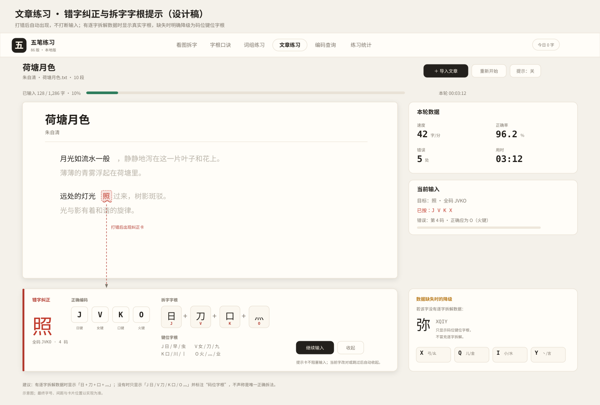
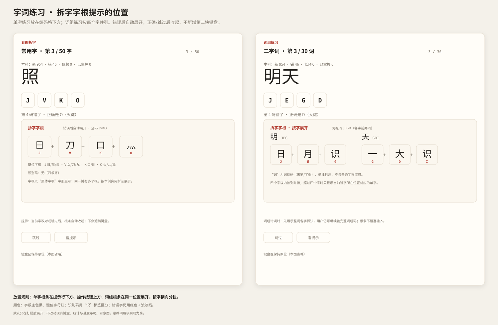

# 错字纠正与拆字字根提示 · 设计（v1.0 已实施）

| 项目 | 内容 |
| --- | --- |
| 文档版本 | 1.0（已实施） |
| 日期 | 2026-11-23 |
| 功能 | 文章、单字、词组练习打错后，显示正确编码、按键、拆字字根与键位提示 |
| 设计图 | `docs/root-hint-design.svg`、`docs/root-hint-placement.svg` |
| 数据 | `data/char_roots.json`（6,756 字）、`web/fonts/wubi-roots.ttf` |
| 结论 | 已实现；字形显示，缺失字降级为码位键位字根 |

---

## 0. 实现结论

已实现三层提示：

1. **文章练习**：纸面下方“错字纠正”卡，显示全码、键位、字根字形与键位字母。
2. **看图拆字（单字）**：打错后，在编码格与提示/按钮之间展开根条；提示行仍保留“第 N 码 · 按 X 键 —— 口诀”。
3. **词组练习**：同一位置展开，按词中每个字横向分栏，显示各字字根；最多 4 栏。

数据来自用户提供的 `search-wubi-main`：

- `data-wubi-v86.tsv` 的 `units`（PUA 字根字形）、`flag`（识别码）、`segments`；
- `data-chars.tsv` 的字级/IDS；
- `黑体字根.ttf` 的 PUA 字形。

已生成 `data/char_roots.json`（6,756 字，约 1.48MB）和 `web/fonts/wubi-roots.ttf`（61KB）。
7 个编码不一致的字（氵、纛、蔻、钅、灬、靥、囗）跳过，使用码位降级。



---

## 1. 实现前的问题

- 打错键 → 当前字标红，错误记录；
- 只显示“正确按键/口诀”，不知道“这个字为什么这样拆”；
- 文章、单字、词组三处没有统一的字根反馈。

现已按本设计补上：文章用纸面下方纠错卡，单字/词组用编码格下方的根条。

---

## 2. 推荐交互

### 2.1 出现时机

- **打错后自动出现**“错字纠正卡”，不弹模态框、不抢焦点、不阻塞继续输入。
- 当前字改对、跳过、或切换到下一个字后自动收起。
- 再次打错时，卡片更新为新错字。
- 文章词组输入失败时，按“当前字”显示；不展开整个词组的拆解。
- 如果当前处于“提示关闭”状态，打错后仍自动出现（因为错字纠正属于错误反馈，不是提前给答案）。

### 2.2 位置

推荐放在**文章纸面下方的横向卡片**（宽度与纸面一致），而不是塞进 258px 侧栏：

- 能同时放下“编码 chips + 4 个字根 + 键位字根”；
- 不遮挡正文；
- 不改变正文排版；
- 不打断打字节奏。

侧栏保留“当前输入”摘要，底部卡片负责详细拆解。

### 2.3 卡片内容（精确数据可用时）

以“照”为例：

```text
错字纠正     照   全码 JVKO · 4 码
             正确编码：J 日键   V 女键   K 口键   O 火键
             拆字字根：日 + 刀 + 口 + 灬
             键位字根：J 日/早/虫 · V 女/刀/九 · K 口/川 · O 火/灬/业
             继续输入 / 收起
```

视觉层级：

1. 左侧大字目标字（红色）；
2. 编码 chips：字母大、键名小；
3. 字根链：字根大、键位字母小、用 `+` 连接；
4. 键位字根：小字辅助，展示该键常见根与口诀；
5. 按钮：“继续输入”主按钮，“收起”次按钮。

### 2.4 数据缺失时的降级

没有逐字拆解数据时：

- 标题旁加琥珀色标签 **“码位字根”**；
- 只显示：`X 弓/幺 · Q 儿/金 · I 小/水 · Y 丶/言`；
- 明确一句：“该字暂无逐字拆解数据，以上为键位常见字根，不是唯一拆法。”
- 绝不把键位常见根拼成“正确拆字”。

### 2.5 文案规则

- 有精确数据：`拆字字根`
- 无精确数据：`码位键位字根`
- 底部小字：`字根数据来自逐字拆解表；未收录时仅展示该键常见字根。`
- 不写“标准答案”四个字，避免把不同教材的拆法差异说死。

### 2.6 字词练习中的位置



单字练习和词组练习都不新增第二块键盘，根提示放在现有练习卡内部：

- **看图拆字（单字）**：根条插在提示行下方、操作按钮上方（即原 hint 区域）；打错后自动展开，正确/跳过后收起。
- **词组练习（词组）**：同一位置展开，按词中每个字横向分栏，显示“字 + 编码 + 字根链”。
- 2–4 字词最多 4 栏；更长的词只显示当前错误位置对应的单字，避免横向溢出。
- 识别码单独用小标签“识”表示，并在根条下方给出“末笔 + 字型 → 识别码”归类说明，不混在普通字根里。
- 键盘、统计、进度条位置不变；根条展开时只让练习卡变高，页面自然滚动。

---

## 3. 数据方案

### 3.1 新增 `data/char_roots.json`

`search-wubi-main` 的 `data-wubi-v86.tsv` 已经提供逐字拆解，但 `units` 是**字根字形**（私有区 PUA 字符），不是普通汉字：

```text
照  jvko  units = 〖\ue085※\ue1fd※\ue09b※\ue189〗
好  vbg   units = 〖\ue1fc※\ue1e1※\ue000〗
弥  xqiy  units = 〖\ue223※\ue132※\ue176※\ue13d〗
```

用配套的 `黑体字根.ttf` 渲染后：照 = 日 刀 口 灬；好 = 女 子 + 识别码；弥 = 弓 + … + 小 + 丶（按字体实际字形）。

建议输出结构：

```json
{
  "version": 1,
  "source": "search-wubi-main/data/data-wubi-v86.tsv + data-chars.tsv + 黑体字根.ttf",
  "font": "wubi-roots.ttf",
  "chars": {
    "照": {
      "code": "jvko",
      "level": "一级",
      "units": ["\ue085", "\ue1fd", "\ue09b", "\ue189"],
      "keys": ["j", "v", "k", "o"],
      "identifyLast": false,
      "segments": [[0,1,2,3], [4,5], [6,7,8], [9,10,11,12]]
    },
    "好": {
      "code": "vbg",
      "level": "一级",
      "units": ["\ue1fc", "\ue1e1", "\ue000"],
      "keys": ["v", "b", "g"],
      "identifyLast": true,
      "identify": {
        "stroke": "横", "strokeName": "横",
        "zone": 1, "structure": "左右", "position": 1,
        "key": "G", "code": "11"
      },
      "segments": [[0,1], [2,3,4]]
    }
  }
}
```

字段：

| 字段 | 说明 |
| --- | --- |
| `units` | PUA 字根字形序列；前端用 `@font-face` 渲染 |
| `keys` | 每个字根对应的键位（来自全码字母） |
| `identifyLast` | 最后一个单位是否为识别码（`flag` 非空时） |
| `segments` | 每个字根对应的笔画下标，可用于后续高亮字形 |
| `level` | 一级/二级/三级等，便于分层加载 |

> **字形 vs 文字名**：`units` 能还原“这个字实际用了哪些字根字形”，但 PUA 本身没有汉字名称。
> 如果要显示“日+刀+口+灬”这样的文字标签，需要额外的 **PUA→字根名** 映射（约 547 个）。
> 首版建议直接显示**字根字形**并配键位字母；这已经是“正确的拆字字根”，不必先用文字猜。

### 3.1.1 实测覆盖与校验

对现有 `data/pools.json` 的 **gb2312 6,763 字**：

| 项目 | 结果 |
| --- | --- |
| `data-wubi-v86.tsv` 可匹配 | 6,756 |
| 编码不一致/特殊部首 | 7：氵、纛、蔻、钅、灬、靥、囗（跳过并报告） |
| `units` 长度 | 4 个根 5,931 字；3 个根 832 字 |
| 识别码 | `flag` 非空 3,012 字，最后一个单位标为识别码 |
| 字级 | 一级 3,498；二级 2,812；三级 328；其他 121 |

`黑体字根.ttf` 的 cmap 为 PUA 字形（686 个映射），已实际渲染验证：
“照”显示为 日 刀 口 灬；“好”显示为 女 子 识别码；“弥”显示为 弓 … 小 丶。

已生成（2026-11-23）：

- `data/char_roots.json`：6,756 字，约 1.48MB；
- `web/fonts/wubi-roots.ttf`：约 61KB；
- `tools/build_char_roots.py`：可重复生成，7 个编码不一致的字会列在 `skipped` 中。

### 3.1.2 识别码分类提示

`data-wubi-v86.tsv` 的 `flag` 已经给出识别码的“末笔 · 字型”，构建时解析成结构化 `identify`：

```text
明  flag = 横·左右〔一 ⿰〕 → G（1 区 1 位，代码 11）
天  flag = 捺·杂合〔丶 ⿻〕 → I（4 区 3 位，代码 43）
汉  flag = 捺·左右〔丶 ⿰〕 → Y（4 区 1 位，代码 41）
春  flag = 横·上下〔一 ⿱〕 → F（1 区 2 位，代码 12）
```

识别码完整分类表（五笔 86）：

| 末笔 \ 字型 | 左右 | 上下 | 杂合 |
| --- | --- | --- | --- |
| 横（一） | G / 11 | F / 12 | D / 13 |
| 竖（丨） | H / 21 | J / 22 | K / 23 |
| 撇（丿） | T / 31 | R / 32 | E / 33 |
| 捺（丶） | Y / 41 | U / 42 | I / 43 |
| 折（乛） | N / 51 | B / 52 | V / 53 |

UI 不只用“识”标签，还在根条下方显示一条归类说明：

```text
明：识别码 = 末笔横 · 左右型 → G（1 区 1 位）
天：识别码 = 末笔捺 · 杂合型 → I（4 区 3 位）
```

- 字形 chip 的 `title` 也带同样分类；
- 词组有多个识别码时逐字列一行；
- 没有 `identify` 数据的字不显示分类，只保留“识”标签。

### 3.2 建议的引入步骤

1. **只取所需数据，不复制整个项目**：
   - `search-wubi-main/data/data-wubi-v86.tsv`（拆解、编码、识别码、笔画段）
   - `search-wubi-main/data/data-chars.tsv`（字级、IDS、部首，用于常用字筛选和校验）
   - `search-wubi-main/docs/static/font/黑体字根.ttf`（PUA 字根字形）
2. 新增 `tools/build_char_roots.py`：
   - 以 `data/pools.json` 的 `gb2312` 为常用字集合；
   - 校验 `data-wubi-v86.tsv` 的 `code` 与 `chars.json` 的 `f`/`s` 一致；
   - 解析 `units`（去 `〖〗`、按 `※` 拆）、`segments`、`flag`；
   - 生成 `data/char_roots.json`；
   - 将不一致的字输出报告，不静默丢弃。
3. 将字体复制为 `web/fonts/wubi-roots.ttf`，新增：
   ```css
   @font-face {
     font-family: "WubiRoots";
     src: url("/static/fonts/wubi-roots.ttf") format("truetype");
     unicode-range: U+E000-EFFF;
   }
   ```
4. 前端按需加载 `char_roots.json`；只对已加载的字显示精确根，其他走 `keys86.json` 降级。
5. 源目录 `search-wubi-main` 保留为原始参考，不直接参与运行时；只在构建时读取。

> 该仓库当前没有看到 LICENSE 文件；本机使用问题不大，若要把数据/字体再分发，需要先确认许可。`search-wubi-main` 是用户提供的本地副本，本文按“本地引入”处理。

### 3.3 前端加载

- 文章页首次进入或第一次打错时，`fetch('/data/char_roots.json')`；
- 失败/未配置 → 全部走码位降级，不影响练习；
- 数据量：6,763 字的 JSON 预计几百 KB；全量 7 万字约 1–2 MB，按需加载即可。
- 不新增后端 API；`/data/` 已由现有服务提供。

### 3.4 键位数据复用

- `keys86.json` 已有：键名、常见字根、口诀、分区、手指；
- 降级时直接用 `key.roots`，不需要新增数据；
- 精确拆解时仍可用它补充“键位字根”第二行。

### 3.5 PUA 字形如何显示

前端不把 `units` 当普通文本，而是：

```html
<span class="root-glyph" title="日键">&#xe085;</span>
```

```css
.root-glyph { font-family: "WubiRoots"; font-size: 26px; }
```

- 字形下方显示键位字母 `J`；
- 最后一枚若是识别码，加小标签“识”；
- 识别码再显示一行“末笔横 · 左右型 → G（1 区 1 位）”；
- 如果字体加载失败，降级为 `keys86.json` 的键位字根文本，不显示乱码方块。

---

## 4. 显示算法

```text
onError(currentChar):
  entry = charRoots[currentChar]        // 可选
  code = chars[currentChar].f or .s
  if entry && entry.code == code:
     renderExact(entry.roots)           // 日 + 刀 + 口 + 灬
  else:
     renderFallback(code)               // J 日/早/虫 ...
  showCard()
```

- 精确/降级只影响“拆字字根”区域，不影响编码 chips、键名、错误提示。
- 识别码单独标记为“识别码”，不与普通字根混在一起。
- 词组输入错误时只取当前字，不把词拆成多字卡片。

---

## 5. 视觉与可用性

- 卡片背景与纸面一致，左边框用错误红；不遮挡正文。
- 根链字号明显大于键位小字；根与键位用不同颜色区分。
- 不为颜色唯一编码：字根 chips 仍带文字，识别码加“识别码”标签。
- 错误字红色 + 波浪线保持不变。
- 卡片出现/收起用 150–200ms 过渡；不滚动页面。
- 移动端：卡片改为纸面下方全宽，根链可横向滚动。

---

## 6. 与现有功能的关系

- 只影响**文章练习**；看图拆字/词组练习不改。
- 不改变学习状态、错题本、进度表。
- 打错后的错误记录仍按当前字计；字根提示不额外记错。
- 文章词组识别逻辑不变；词组错误时显示当前字的根提示。
- 不新增数据库表；只新增静态数据文件（若采用精确方案）。

---

## 7. 已确认 / 仍需确认

| # | 决策 | 状态 / 建议 |
| --- | --- | --- |
| 1 | 精确拆字 + 码位降级双轨 | **已确认：接受** |
| 2 | 先做常用字 | **已确认：先做 6,763 常用字** |
| 3 | 引入逐字拆解数据 | **已确认：引入 `search-wubi-main` 数据** |
| 4 | 打错后自动出现 | **已确认：是** |
| 5 | 卡片位置 | **文章：纸面下方横向卡片**；字词：提示行下方、按钮上方（见 2.6） |
| 6 | 识别码 | **显示**，单独标注“识” |
| 7 | 词组错误 | 只显示当前错误位置相关的字；2–4 字词按字分栏 |
| 8 | 无数据时 | 明确标“码位字根”，不冒充拆字 |
| 9 | 字根显示形态 | **已确认：字根字形（PUA 字体）+ 键位字母**；不做汉字名映射 |

> 用户已确认 1–9。实现采用字形显示：`units` 由 `web/fonts/wubi-roots.ttf` 渲染，PUA 本身不需要汉字名。

---

## 8. 实施记录

| 阶段 | 状态 |
| --- | --- |
| 双轨、常用字、数据引入 | **已完成** |
| `tools/build_char_roots.py` + `data/char_roots.json` | **已完成**（6,756 字，7 个 skipped） |
| `黑体字根.ttf` → `web/fonts/wubi-roots.ttf` | **已完成** |
| 文章错误卡（精确 + 降级） | **已完成** |
| 单字根条（slots 与提示之间） | **已完成** |
| 词组根条（按字分栏） | **已完成** |
| 现有错误、词组输入、进度联调 | **已完成** |
| 识别码分类（末笔/字型/区位） | **已完成**：3,012 字，UI 显示归类行 |
| 字形字体加载、降级、移动端 | **已完成基础验证** |

可验证的示例（用 `黑体字根.ttf` 渲染）：

- 照 = J(日) + V(刀) + K(口) + O(灬)；
- 好 = V(女) + B(子) + G(识别码)；
- 弥 = X(弓) + … + 小 + 丶（按字体实际字形）。
